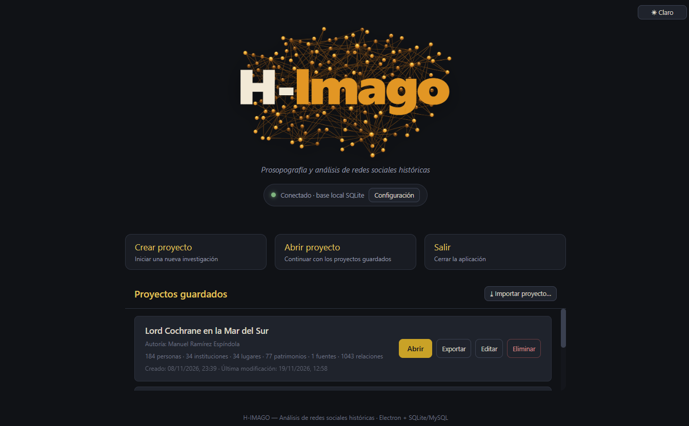
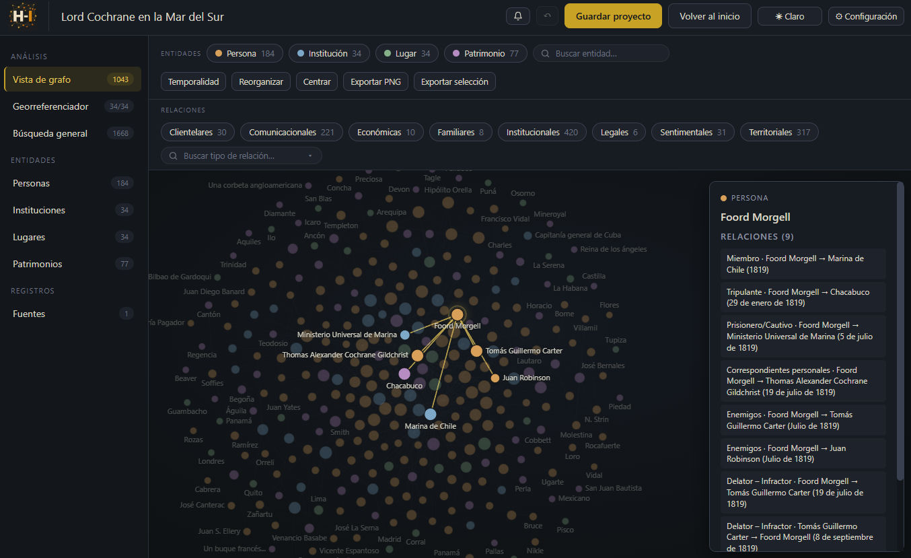
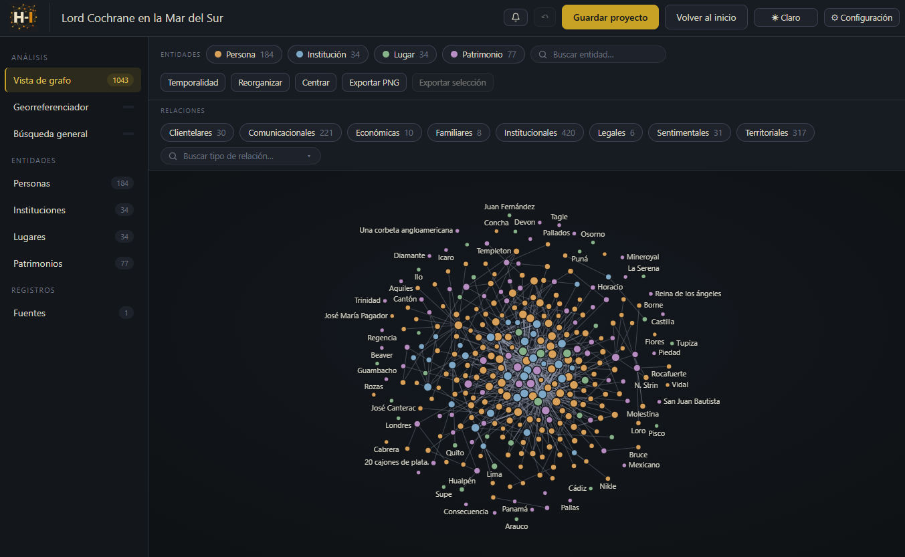
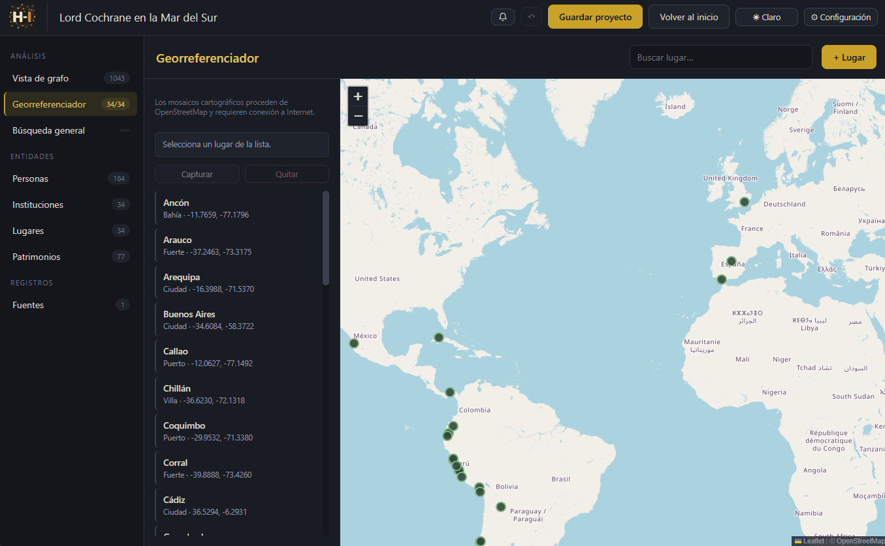
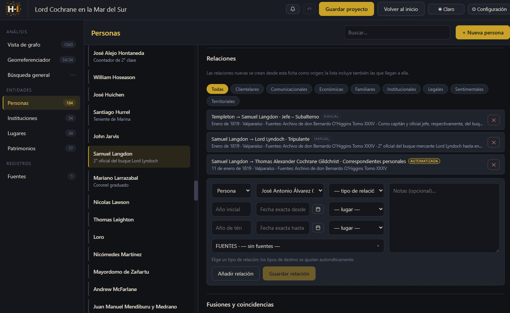
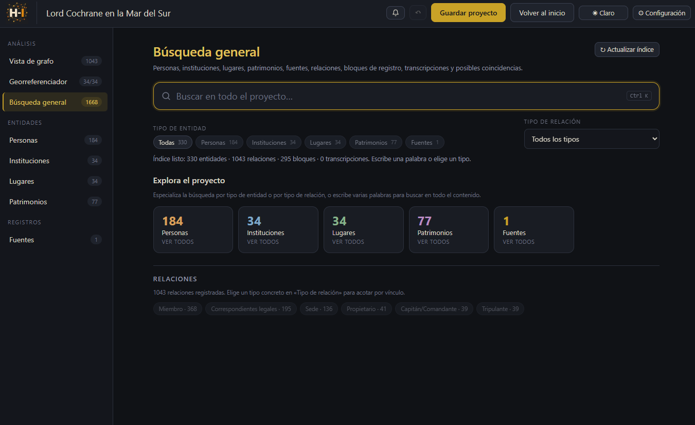
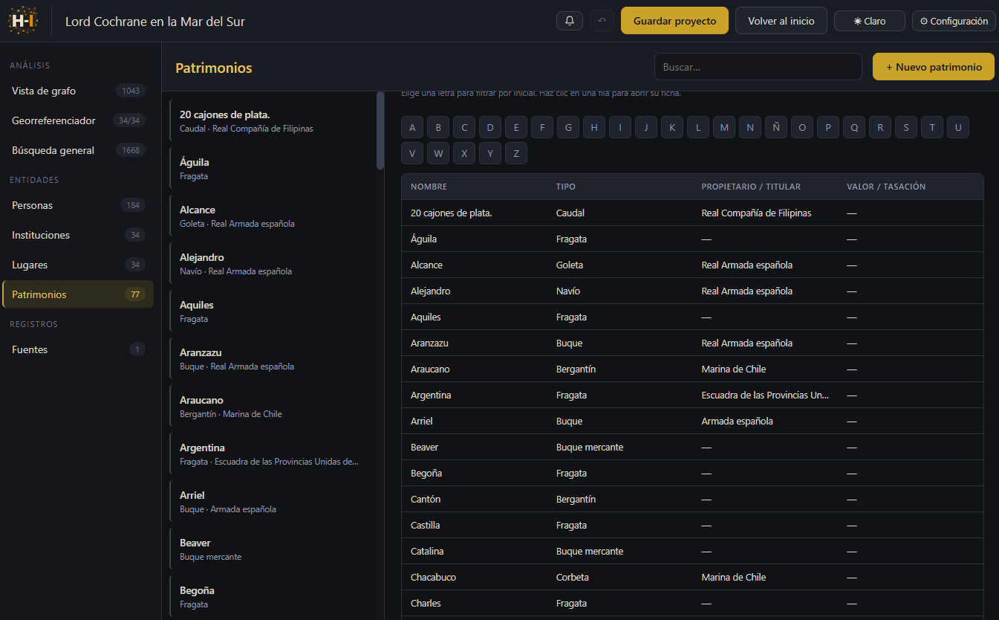
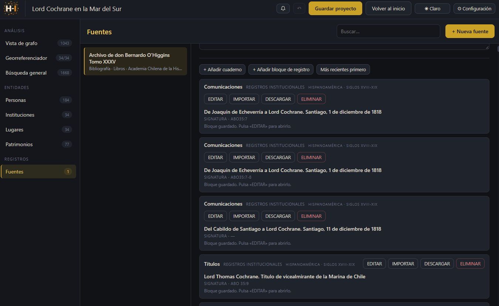
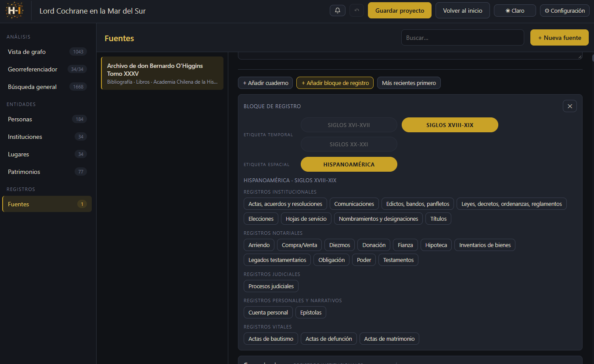

<p align="center">
  <picture>
    <source media="(prefers-color-scheme: dark)" srcset="src/assets/logo-himago-oscuro.png">
    <source media="(prefers-color-scheme: light)" srcset="src/assets/logo-himago-claro.png">
    
  </picture>
</p>

# H-IMAGO

[](https://mre1302.github.io/H-Imago/)
[](https://doi.org/10.5281/zenodo.24475874)
[](https://github.com/sponsors/mre1302)

Aplicación de escritorio (Electron + SQLite/MySQL) para la **investigación prosopográfica** y la **visualización de redes sociales históricas**.

**Web del proyecto:** [mre1302.github.io/H-Imago](https://mre1302.github.io/H-Imago/)

## Descargar H-IMAGO

**No necesitas saber programar ni usar Git.** Descarga el archivo correspondiente a tu sistema y ábrelo.

**Versión 0.0.29** · 27 de noviembre de 2026

| Sistema | Descarga | Cómo se usa |
|---|---|---|
| **Windows 10/11 (64 bits)** | [**Instalador H-IMAGO**](https://github.com/mre1302/H-Imago/releases/download/v0.0.29/H-IMAGO-0.0.29-Setup.exe) | Recomendado. Abre el archivo y sigue el asistente. |
| **Windows portable** | [**H-IMAGO portable (ZIP)**](https://github.com/mre1302/H-Imago/releases/download/v0.0.29/H-IMAGO-0.0.29-win-x64-portable.zip) | Descomprime el ZIP y ejecuta `H-IMAGO.exe`. |
| **Linux (AppImage)** | [**H-IMAGO AppImage**](https://github.com/mre1302/H-Imago/releases/download/v0.0.29/H-IMAGO-0.0.29.AppImage) | Dale permisos de ejecución (`chmod +x H-IMAGO-0.0.29.AppImage`) y ábrelo. |
| **Debian / Ubuntu (64 bits)** | [**Paquete .deb**](https://github.com/mre1302/H-Imago/releases/download/v0.0.29/h-imago_0.0.29_amd64.deb) | Ábrelo con el instalador de paquetes o instálalo con `sudo apt install ./h-imago_0.0.29_amd64.deb`. |

También puedes ver todos los archivos en la [página de la release](https://github.com/mre1302/H-Imago/releases/tag/v0.0.29). Para futuras versiones, consulta [Releases](https://github.com/mre1302/H-Imago/releases).

> **Nota para Windows:** el instalador de la versión 0.0.29 todavía no está firmado digitalmente. Es posible que SmartScreen muestre una advertencia. Si decides continuar, pulsa **Más información → Ejecutar de todas formas**.
>
> **Firma de código:** cuando SignPath Foundation apruebe la solicitud, las builds de Windows se firmarán con SignPath.io y el certificado de SignPath Foundation. Consulta la [política de firma de código](CODE_SIGNING.md).

**Requisitos:** Windows 10/11 de 64 bits o Linux de 64 bits. No hace falta instalar Node.js, Git ni una base de datos. En modo personal, SQLite va incluido.

> **macOS:** la compilación está preparada en el repositorio, pero aún no hay artefactos publicados. Puede generarse desde el workflow manual `macOS build` de GitHub Actions.

### Verificar descargas

La versión 0.0.29 incluye `SHA256SUMS-windows.txt` y
`SHA256SUMS-linux.txt`. En Linux:

```bash
sha256sum -c SHA256SUMS-linux.txt
```

En Windows (PowerShell):

```powershell
Get-FileHash .\H-IMAGO-0.0.29-Setup.exe -Algorithm SHA256
Get-AuthenticodeSignature .\H-IMAGO-0.0.29-Setup.exe
```

Las builds de Linux no llevan firma Authenticode; su integridad se comprueba con
las sumas y con la atestación de procedencia de GitHub Actions:

```bash
gh attestation verify H-IMAGO-0.0.29.AppImage --repo mre1302/H-Imago
```

## Novedades de 0.0.29

- **Análisis RSH**: capa opcional de análisis de redes sociales históricas con
  grado, intermediación, cercanía, vector propio/PageRank, comunidades Leiden,
  densidad y componentes. Se calcula en local, bajo demanda, y exporta los
  resultados a CSV. Detalles en [`docs/ANALISIS-RSH.md`](docs/ANALISIS-RSH.md).
- **Vista de grafo**: filtros de entidades y relaciones, barra de estado,
  flechas de dirección, agrupación de relaciones paralelas, detalle de vínculos,
  vecindad a uno o dos saltos, histograma temporal con reproducción, vistas
  guardadas, tabla accesible y opciones de exportación PNG.
- **Relaciones**: 183 tipos en 8 categorías, dirección según NRELACIONES y
  validación de las entidades de origen y destino. La matriz pública está en
  [`docs/NRELACIONES.md`](docs/NRELACIONES.md).
- **Datos y estabilidad**: migraciones V9 y V10, sugerencias de bloques y mejoras
  de importación de cuadernos y proyectos.
- **Documentación y firma**: se publican la arquitectura, la metodología del
  Análisis RSH, la matriz de relaciones y la configuración de referencia de
  SignPath en [`.signpath/README.md`](.signpath/README.md).

## Capturas

<table>
  <tr>
    <td width="50%">
      
      <br><sub>Inicio y proyectos guardados</sub>
    </td>
    <td width="50%">
      
      <br><sub>Detalle de la red y relaciones</sub>
    </td>
  </tr>
  <tr>
    <td width="50%">
      
      <br><sub>Grafo con etiquetas</sub>
    </td>
    <td width="50%">
      
      <br><sub>Georreferenciador</sub>
    </td>
  </tr>
  <tr>
    <td width="50%">
      
      <br><sub>Personas y relaciones</sub>
    </td>
    <td width="50%">
      
      <br><sub>Búsqueda general</sub>
    </td>
  </tr>
  <tr>
    <td width="50%">
      
      <br><sub>Patrimonios</sub>
    </td>
    <td width="50%">
      
      <br><sub>Fuentes y registros</sub>
    </td>
  </tr>
  <tr>
    <td colspan="2" align="center" width="100%">
      
      <br><sub>Bloques de registro</sub>
    </td>
  </tr>
</table>

## Estructura de la aplicación

1. **Index**
   1.1. Crear proyecto
   1.2. Abrir proyecto
   1.3. Salir
2. **Proyecto**
   2.1. Vista de grafo - red social histórica (simulación de fuerzas, arrastrar nodos, zoom, filtros, exportar PNG y Análisis RSH opcional)
   2.2. Georreferenciador — mapa OpenStreetMap (Leaflet) para capturar coordenadas de los lugares
   2.3. Búsqueda general — índice de entidades, relaciones, bloques y transcripciones, con filtros por tipo
   2.4. Personas — fichas prosopográficas
   2.5. Instituciones
   2.6. Lugares
   2.7. Patrimonios
   2.8. Fuentes — con transcripciones
3. **Guardar proyecto** (también con `Ctrl+S`)
4. **Volver al inicio** (index)
5. **Configuración** — modo personal (SQLite) o modo equipo (MySQL/MariaDB)

Cada registro (personas, instituciones, lugares y patrimonios) admite **relaciones
dirigidas** (parentesco, patronazgo, membresía, conflicto…) que alimentan la vista
de grafo. Las fechas admiten dataciones imprecisas de uso historiográfico
(`c. 1520`, `antes de 1503`, `fl. 1489-1512`).

En las **PERSONAS**, NOMBRE y APELLIDOS son alternativos: basta con uno de los
dos. El directorio y las listas se ordenan por APELLIDOS y, como criterio
secundario, por NOMBRES; quien no tenga apellidos se ordena por su nombre.

## Requisitos

- [Node.js](https://nodejs.org) (v22.12 o superior) y npm, solo para desarrollo
- Para el **modo personal**: nada más; SQLite va integrado en la aplicación
- Para el **modo equipo**: un servidor **MySQL** o **MariaDB** en marcha (local o remoto)

## Modos de trabajo

- **Personal · SQLite (por defecto)**: la aplicación guarda todo en un archivo
  local (`himago.db`) en la carpeta de datos de H-IMAGO. No hay que instalar
  servidor, usuario ni contraseña. Es el modo recomendado para investigación
  individual y trabajo sin conexión.
- **Equipo · MySQL/MariaDB**: varias personas conectan a una misma base de datos
  central. Requiere un servidor accesible y credenciales. Es el modo adecuado
  para equipos, archivos institucionales y trabajo en red.

Los proyectos de cada modo son independientes. Para trasladar un proyecto de un
modo a otro se usa **Exportar** en el índice y **Importar** en el otro modo.

## Instalación

```bash
npm install
```

## Ejecución

```bash
npm start
```

El script usa `--disable-dev-shm-usage`; el sandbox de Chromium permanece
activo por defecto. Si el entorno no puede lanzarlo (contenedores muy
restringidos o Linux sin `chrome-sandbox`), usa `npm run start:sin-sandbox`.

La aceleración por hardware está activa por defecto. En equipos Linux sin GPU
puedes arrancar con `HIMAGO_SIN_GPU=1 npm start`.

### Compilar para macOS

La aplicación puede empaquetarse para macOS con electron-builder. Requiere un Mac
o un runner macOS de GitHub Actions. Genera DMG y ZIP para Intel y Apple Silicon:

```bash
npm run dist:mac:x64
npm run dist:mac:arm64
```

El workflow manual `macOS build` genera ambos artefactos sin firmar. macOS puede
mostrar una advertencia de Gatekeeper; para una distribución sin advertencias hay
que firmar con un certificado Developer ID y notarizar la app.

### Pruebas y calidad

```bash
npm run lint       # ESLint
npm run check      # sintaxis de los módulos principales
npm test           # auditoría, mejoras, rutas y MySQL (omitido si no se activa)
npm run verificar  # lint + check + test
npm run bench:analisis  # rendimiento de las métricas de Análisis RSH
```

La integración MySQL se activa con `HIMAGO_TEST_MYSQL=1` y las variables
`HIMAGO_MYSQL_*`; GitHub Actions la ejecuta contra un servicio MySQL 8.0. La
arquitectura, el flujo `.ods → generador → JS` y las migraciones se explican en
[`docs/ARQUITECTURA.md`](docs/ARQUITECTURA.md).


Al primer arranque la aplicación crea automáticamente la base local SQLite y
queda lista para crear proyectos, sin configuración. Para cambiar de modo, pulsa
**Configuración** en la pantalla de inicio (o el botón ⚙ en la barra del
proyecto):

- **Personal · SQLite**: indica, si quieres, otra ruta para el archivo `.db`
  dentro de la carpeta de datos de H-IMAGO, Documentos, Escritorio, Descargas o
  una carpeta temporal. Las rutas fuera de esas ubicaciones se rechazan por
  seguridad.
- **Equipo · MySQL/MariaDB**: introduce host, puerto, usuario, contraseña y
  nombre de base de datos (por defecto `himago`); usa **Probar conexión** y
  **Guardar y conectar**. La base y las tablas se crean automáticamente.
  Para servidores remotos, TLS se activa por defecto; si el certificado es de
  confianza, mantén **Verificar el certificado del servidor**. Si el servidor usa
  una CA privada, pega su certificado en **CA del servidor**. Desactivar la
  verificación solo debe hacerse con un certificado autofirmado controlado.
  Las migraciones de una base existente crean antes una copia con `mysqldump`
  en `~/.himago/backups` (o `HIMAGO_BACKUP_DIR`); si no está disponible, la
  migración se detiene para no perder datos.

> En modo equipo, si no quieres usar `root`, crea un usuario dedicado:
>
> ```sql
> CREATE USER 'himago'@'localhost' IDENTIFIED BY 'cambia_esta_contraseña';
> GRANT ALL PRIVILEGES ON himago.* TO 'himago'@'localhost';
> FLUSH PRIVILEGES;
> ```

## Esquema de datos (se crea automáticamente)

| Tabla          | Contenido                                                                 |
| -------------- | ------------------------------------------------------------------------- |
| `proyectos`    | Proyectos de investigación                                                |
| `personas`     | Fichas prosopográficas (nombre, alias, género, años y fechas exactas, lugares de nacimiento y de defunción, institución/ocupación…) |
| `instituciones`| Corporaciones (tipo, años y fechas exactas de fundación/disolución, sede → `lugares`) |
| `lugares`      | Topónimos con latitud/longitud decimales                                  |
| `patrimonios`  | Mayorazgos, señoríos, obras, colecciones… (propietario desde la lista de PERSONAS, ubicación, valor) |
| `fuentes`      | Archivos, crónicas, notariales… datación por años + fecha exacta, con transcripción |
| `relaciones`   | Aristas dirigidas entre entidades (tipo de la taxonomía, año/término y fechas exactas, lugar de inicio y de término, notas, fuentes de respaldo vía `relaciones_fuentes`). La procedencia (`MANUAL`, `AUTOMATIZADA`, `EDITADA`) y, en las nacidas de un bloque, `bloque_id`, `regla` y `firma` |
| `relaciones_exclusiones` | Huellas de relaciones automatizadas eliminadas para que su bloque de registro no las vuelva a crear |
| `bloque_referencias` | Índice de entidades citadas por el JSON de cada bloque de registro (rendimiento e integridad) |

## Notas

- **Barra del proyecto**: «↶» deshace el último cambio de la ficha abierta
  (Ctrl+Z); la campana indica si hay cambios pendientes de guardar. «Guardar
  proyecto» (Ctrl+S) guarda la ficha pendiente y actualiza el estado.
- **Tipos de entidad**: los campos «Tipo» de instituciones, lugares y patrimonios
  son de texto libre; no hay listas predefinidas de tipos.
- **Lugares de las personas**: los campos «Lugar de nacimiento» y «Lugar de
  defunción» son listas de los LUGARES del proyecto. Los valores antiguos que
  aún no estén registrados como lugar se conservan como «(actual) …».
- **Propietario/titular**: en Patrimonios es una lista de las PERSONAS del
  proyecto; los valores antiguos no registrados se conservan como «(actual) …».
- **Relaciones manuales desde las fichas**: al guardar una PERSONA con
  OCUPACIÓN / OFICIO e INSTITUCIÓN (OCUPACIÓN) se crea una relación **MANUAL**
  `Persona · Miembro · Institución` si no existe ya una de tipo `Miembro` con
  esa institución. Al guardar una INSTITUCIÓN con SEDE / LUGAR se crea una
  relación **MANUAL** `Institución · Sede · Lugar` si no existe ya. Al guardar
  un PATRIMONIO con PROPIETARIO/TITULAR se crea una relación **MANUAL**
  `Persona · Propietario · Patrimonio` si no existe ya. Se crean sin fechas ni
  fuentes y pueden completarse desde RELACIONES. Cambiar la institución, la sede
  o el propietario no elimina las relaciones anteriores.
- **Imprimir fichas**: las fichas de personas, instituciones, lugares y
  patrimonios incorporan «IMPRIMIR», que genera una hoja con los datos de la
  ficha y el listado de RELACIONES.
- **Corrección ortográfica**: los campos de texto y las transcripciones
  subrayan las palabras dudosas mientras se escribe. El menú contextual ofrece
  sugerencias y la opción «Añadir al diccionario»; se usa el diccionario
  español de Electron (puede descargarse la primera vez).
- **Temas claro/oscuro**: botón ☀/☾ en la barra del proyecto y en el inicio. La
  preferencia se recuerda entre sesiones y afecta al grafo y al georreferenciador.
- **Distribución**: los artefactos de `dist/` se generan con `electron-builder`;
  para una distribución institucional se recomienda firmar el instalador y
  publicar sus hashes. La configuración incluye fuses de Electron para desactivar
  `ELECTRON_RUN_AS_NODE`, la inspección por línea de comandos y la carga de código
  fuera del ASAR.
- **Logotipo**: la barra superior del proyecto muestra el monograma **H-I** con
  sus variantes clara y oscura (`src/assets/marca-himago-claro.webp` y
  `marca-himago-oscuro.webp`), conmutadas según el tema sin descargar las dos;
  la pantalla de inicio conserva las variantes doradas del H-Imago original.
  El icono de escritorio (`build/icon.png`, regenerable con `python3 scripts/icono.py`) lo incorpora
  dentro del sello dorado.
- **Temporalidad profesional**: el tiempo se expresa con **Año de inicio + Año de
  término** (numéricos, ordenables y filtrables) y **FECHA EXACTA** como texto
  libre en DESDE y HASTA cuando el documento la da («19-X-1469»). Los antiguos
  campos de texto impreciso se conservan en la BD como respaldo histórico y sus
  años se migraron automáticamente a los campos estructurados. La datación
  aproximada («c. 1451») se expresa con el intervalo de años.
- **Taxonomía de RELACIONES**: las relaciones usan un vocabulario categorizado
  (Clientelar, Comunicacional, Económica, Familiar, Institucional, Legal,
  Sentimental, Territorial — 183 tipos según la taxonomía del proyecto, en
  `src/js/modulos/taxonomia-relaciones.js`). La etiqueta « – » nombra el lado origen y el
  lado destino («Capataz – Subalterno»); « / » agrupa tópicos de un mismo lado y
  las etiquetas sin « – » comparten el mismo nombre en ambos lados.
  La columna **DIRECCIÓN** de NRELACIONES determina si el vínculo se dibuja con
  flecha simple o doble. La matriz completa está en
  [`docs/NRELACIONES.md`](docs/NRELACIONES.md). Cada tipo declara además qué tipos
  de entidad pueden actuar como **origen** y como **destino**, según NRELACIONES:
  el formulario solo ofrece las combinaciones válidas, ajusta el tipo de destino
  al elegir la relación (y viceversa) y marca con ⚠ las relaciones existentes
  que no cumplan la restricción. Salvo «Apresado/retenido», los patrimonios no
  pueden ser origen de relaciones de la taxonomía; sí pueden ser destino (por
  ejemplo, «Propietario»). Existe una vía para especificar tipos personalizados,
  que no tienen restricciones de entidad.
  Las antiguas etiquetas `Notario/Escribano` y `Otorgante – Notario/Escribano`
  se unificaron como `Escribano/Notario` y `Otorgante – Escribano/Notario`;
  las relaciones existentes se migran automáticamente al abrir la base.
  La antigua etiqueta `Espiado` se renombró como `Espía – Espiado`, y
  `Infiltrado` se unificó en `Espía/Infiltrado`. `Guardia – Dependiente`,
  `Administrador`, `Fiscal – Litigante`, `Juez – Litigante` y
  `Secuestrador/Apresador` dejaron de ofrecerse; las relaciones antiguas con
  esas etiquetas se conservan como heredadas. Las demás etiquetas antiguas del
  mapeo se renombran automáticamente al migrar la base; `Ruptura` se conserva
  como etiqueta heredada.
  El bloque de relaciones incluye una barra de categorías (Clientelares,
  Comunicacionales, Económicas, Familiares, Institucionales, Legales,
  Sentimentales, Territoriales)
  que filtra la lista; por defecto se muestran todas. Los tipos registrados al
  margen de la taxonomía (etiquetas antiguas) aparecen en «Todas».
  El formulario incorpora al pie el campo **FUENTES**, con selección múltiple
  de las fuentes del proyecto, para vincular una o varias como respaldo
  documental de la relación. La lista de relaciones muestra esas fuentes.
- **Edición**: las relaciones se editan haciendo clic sobre ellas (se cargan en el
  formulario de alta; «Guardar relación» salva los cambios y «Cancelar edición»
  sale). Se puede cambiar el otro extremo (tipo de entidad y ficha) desde el
  mismo formulario; la ficha actual permanece fija como origen o destino. Los
  proyectos se editan desde el índice con el botón «Editar» (nombre, creador y
  descripción).
- **Relaciones automatizadas desde BLOQUES DE REGISTRO**: al guardar un bloque,
  sus reglas materializan los vínculos del formulario como relaciones con
  procedencia `AUTOMATIZADA`, conservando `bloque_id`, `regla` y `firma`.
  Se respetan las relaciones `EDITADA`, las exclusiones y las entidades
  existentes; al re-guardar se actualizan las automatizadas y al eliminar el
  bloque se conservan las editadas. El detalle completo de las reglas de los
  25 formularios forma parte de la documentación interna del proyecto.
- **Directorio alfabético**: al entrar en Personas, Instituciones, Lugares,
  Patrimonios o Fuentes, el panel derecho muestra un directorio con barra
  A–Z (+ Ñ) y tabla de la entidad; la letra filtra por inicial (en Personas la
  ordenación es por apellidos) y al pulsar una fila se abre su ficha. El botón
  «☰ Directorio» de la ficha vuelve al listado alfabético.
- **Filtro temporal del grafo**: la barra de VISTA DE GRAFO incorpora un rango de
  años con doble deslizador, campos «De / a» y «Afinar intervalo». El rango
  general se calcula **exclusivamente con los años de inicio y término de
  RELACIONES**; el campo **FECHA EXACTA no interviene** en la temporalidad del
  grafo ni del Análisis RSH. El gráfico mantiene visibles todas las entidades y
  filtra las relaciones cuyo periodo solapa con el rango elegido. Las relaciones
  sin datación permanecen visibles.
  Un contador indica cuántas entidades y relaciones quedan a la vista.
- **Taxonomía de FUENTES**: dos niveles —14 categorías y 64 tipos de fuente—
  según la tabla de taxonomía interna del proyecto. La ficha de fuente
  ofrece la categoría y un selector de tipos dependiente; al elegir categoría
  sólo se muestran sus tipos, y al editar fuentes antiguas se conserva su tipo
  previo aunque no pertenezca a la taxonomía.
- **Formularios condicionales de FUENTES**: la ficha cambia según categoría y
  tipo. General: Título · Autor/productor · Categoría · Tipo · Desde · Hasta ·
  Lugar · Repositorio · Fondo · Signatura · Notas. Bibliografía: Libro
  (Año · Lugar · Editorial), Capítulo (Editor · Libro · Páginas · Año · Lugar ·
  Editorial), Artículo (Revista · Lugar · Año de publicación · Año · Volumen ·
  Número · DOI), Actas (Evento · Año · Lugar) y Tesis (Año · Facultad ·
  Universidad). Los antiguos campos de ubicación/referencia se migraron a
  Repositorio/Signatura; la transcripción sigue almacenada aunque ya no se
  muestra en el formulario.
- **Cuadernos de transcripción (FUENTES)**: bajo el formulario, «+ Añadir
  cuaderno» crea cuadernos de texto extenso (uno o varios por fuente, tabla
  `cuadernos` en cascada). Cada cuaderno tiene en su cabecera **NUMERAR LÍNEAS**
  (gutter de números sincronizado con el desplazamiento) e **INSERTAR FOJA**
  (introduce una línea en blanco y reinicia la numeración en una nueva foja,
  tantas veces como se quiera; las fojas se guardan con el cuaderno) y en el
  pie **CERRAR · GUARDAR · EDITAR · ELIMINAR** con confirmación de descartes.
- **Bloques de registro (FUENTES)**: «+ Añadir bloque de registro» despliega dos
  barras de etiquetas: **temporal** (SIGLOS XVI-XVII · XVIII-XIX · XX-XXI) y
  **espacial** (HISPANOAMÉRICA). Por ahora sólo está habilitada la combinación
  **HISPANOAMÉRICA · SIGLOS XVIII-XIX**, con los **25 formularios** agrupados en
  cinco categorías. Cada bloque guarda su etiqueta temporal y espacial. Cada
  formulario se genera desde el esquema declarativo
  `formularios-bloques.js` (producido por
  `scripts/generar-formularios-bloques.py` a partir de la fuente local de
  formularios, que no se distribuye): secciones, campos (texto, área, año, fecha
  histórica con calendario dual, lugar, institución, select), bloques de
  personas con vínculo a PERSONAS o creación directa, bloques de patrimonios con
  vínculo o creación, y grupos repetibles (Procesos judiciales e Inventarios
  de bienes, Testamentos y Legados testamentarios, y las secciones DEBE y
  HABER de Cuenta personal, con categorías e ítems repetibles, subtotales por
  categoría y totales generales calculados automáticamente). Los bloques se
  guardan como JSON en la tabla `bloques_registro` y admiten EDITAR · GUARDAR ·
  CANCELAR · CERRAR · ELIMINAR. Todos los formularios comparten el mismo patrón:
  **TÍTULO** y **SIGNATURA** (a su derecha, con el ancho de LUGAR) en la primera
  línea; LUGAR/INSTITUCIÓN (o PARROQUIA en las actas vitales)/AÑO/FECHA EXACTA
  en la línea siguiente; y, en los formularios de personas, roles en dos líneas
  con empleo repetible, institución de texto y vínculos (con las
  particularidades de SOLDADO en Hojas de servicio). La tarjeta del bloque
  muestra, bajo la cabecera, el **TÍTULO** y la **SIGNATURA** de la sección
  REGISTRO. El archivo
  `formularios-bloques.js` es generado: no se edita a mano; los cambios se hacen
  en la fuente local de formularios y se regeneran con el script.
- **Varias instituciones por persona**: en los roles de personas, cada línea
  EMPLEO/OFICIO + INSTITUCIÓN es un vínculo institucional independiente. Cada
  línea incorpora su propio **VINCULAR INSTITUCIÓN** y **＋ Crear institución**,
  que crea la institución desde el nombre escrito en esa misma línea y la
  vincula a ella. La persona se elige una sola vez en **VINCULAR PERSONA**.
  Todas las instituciones de las líneas se guardan en el bloque y generan
  relaciones `Miembro`; la primera actúa como institución principal. En
  CUERPOS Y CAMPAÑAS (Hojas de servicio) cada línea de institución funciona
  igual.
- **Descargar e importar un bloque**: cada tarjeta de bloque incorpora
  **DESCARGAR** e **IMPORTAR** entre EDITAR y ELIMINAR. DESCARGAR guarda un
  archivo JSON con el bloque y las entidades a las que hace referencia.
  IMPORTAR solo admite archivos creados por esta función y exige que el tipo del
  bloque coincida con la tarjeta de destino. Al importar se reemplaza el
  contenido del bloque y se regeneran sus relaciones automatizadas; las
  relaciones **EDITADA** se conservan. Si el bloque procede de otro proyecto,
  se reutilizan las entidades coincidentes o se crean las que falten.
- **Hipotecas asociadas a la persona**: en Arriendo, Compra/Venta, Diezmos,
  Fianza, Hipoteca y Obligación, los antiguos bloques HIPOTECA ya no son
  secciones independientes: aparecen dentro de la sección de la persona
  correspondiente, debajo de VINCULAR PERSONA, con títulos como
  `HIPOTECA ARRENDATARIO`, `HIPOTECA COMPRADOR` o `HIPOTECA FIADOR/AVAL`.
  Se replican por cada fila de persona y sus datos se guardan dentro de esa
  persona; los datos antiguos se trasladan a la primera fila del rol al abrir
  el bloque.
- **Legados testamentarios y Testamentos · ALBACEAS y PATRIMONIOS**: en Legados
  la sección HEREDEROS se duplica como **ALBACEAS**, situada inmediatamente
  después, con su propia lista de personas, vínculos, empleos e institución.
  Testamentos ya incluye una sección ALBACEAS idéntica, por lo que no se
  duplica. En ambos formularios, a continuación de los totales del
  **INVENTARIO** se añade un bloque repetible **PATRIMONIOS**, con NOMBRE,
  VALOR/TASACIÓN, TIPO y VINCULAR PATRIMONIO, igual que las antiguas
  subsecciones HIPOTECA.
- **Epístolas**: conserva las secciones REMITENTE y DESTINATARIO; se ha
  retirado la sección ESCRIBANO/NOTARIO.
- **Actas de matrimonio y bautismo · CONDICIÓN**: en matrimonio son listas los
  campos CONDICIÓN de NOVIO y NOVIA, y en bautismo el campo CONDICIÓN de
  ANTECEDENTES VITALES. Opciones: **Legítimo, Natural, Padres no conocidos,
  Padre no conocido, Madre no conocida y No informada**. Los valores antiguos
  se conservan como «(actual) …».
- **Hojas de servicio · SERVICIOS**: cada línea se mide desde su **INICIO**
  hasta el INICIO de la línea siguiente; la última se cierra con la **FECHA
  EXACTA** de la sección REGISTRO (también cuando sólo hay una línea). Los
  campos AÑOS/MESES/DÍAS se calculan automáticamente (sólo lectura) por
  diferencia calendario-aware (juliano, gregoriano o era hispánica) y los
  TOTALES suman las líneas y se auditan en cascada: 30 días = 1 mes y
  12 meses = 1 año.
- **Fechas históricas (FECHA EXACTA)**: además del texto literal, cada fecha
  exacta guarda un modelo estructurado (año/mes/día, sistema y precisión) en una
  columna `_meta`. El botón de calendario abre un **calendario histórico** con
  conversión por día juliano (más allá de 1582 y hasta el 45 a. C. en cómputo
  proléptico), selector de sistema (gregoriano · juliano · era hispánica) y
  precisión (día · mes · año · aproximada · rango). Solo se muestra el calendario
  seleccionado. Al abrirlo, el año de la vista parte del valor del campo AÑO
  asociado (o de la fecha ya escrita); si no hay ninguno, se mantiene 1582. El
  parser reconoce «19-X-1469», «19 de octubre de 1469», «octubre de 1469»,
  «c. 1520», «entre 1489 y 1512», «era 1507»… sin reescribir el literal salvo
  al aplicar una fecha del calendario. Aplicado a Personas, Instituciones,
  Relaciones y bloques de registro.
- **Identificadores de entidad**: cada persona, institución, lugar y patrimonio
  recibe un ID alfanumérico secuencial por proyecto (`PE00001`, `IN00001`,
  `LU00001`, `PA00001`), visible bajo el título de su ficha. Los registros
  anteriores se numeran automáticamente al abrir la base.
- **Fusiones y coincidencias (datos auxiliares)**: bajo RELACIONES, cada ficha
  permite **FUSIONAR** con otra del mismo tipo (la ficha abierta sobrevive:
  hereda las relaciones y los campos vacíos de la absorbida, que se elimina —
  acción irreversible con advertencia) y registrar una **POSIBLE COINCIDENCIA**
  con notas, eliminable como una relación. No intervienen en el grafo ni en los
  análisis; solo acompañan al proyecto (también en su exportación).
- **Proyectos portátiles**: desde el índice, «Exportar» en cada tarjeta guarda el
  proyecto como archivo `.json` (formato `h-imago-proyecto`) mediante diálogo
  nativo; «⤓ Importar proyecto…» en el panel lo reincorpora con remapeo de
  referencias internas. El archivo incluye entidades, relaciones con su
  procedencia, cuadernos, **BLOQUES DE REGISTRO**, exclusiones y coincidencias;
  al importar se reconstruyen los vínculos automatizados de los bloques. Es la
  vía de respaldo e intercambio entre investigadores y entre SQLite y MariaDB.
  El tamaño máximo de importación es de 50 MB.

- **Búsqueda general**: índice en memoria del proyecto que cruza entidades,
  relaciones, bloques de registro, transcripciones y posibles coincidencias.
  Acepta varias palabras (todas deben aparecer), ignora tildes y mayúsculas y
  permite acotar por **tipo de entidad** (chips) y por **tipo de relación**
  (selector agrupado por categorías). Los resultados se agrupan por sección,
  muestran el fragmento coincidente resaltado y abren la ficha, el bloque o el
  cuaderno correspondiente. `Ctrl+K` enfoca el buscador y `Esc` limpia la
  consulta o los filtros.
- **Georreferenciador**: la cartografía (mosaicos de OpenStreetMap) necesita
  conexión a Internet. Leaflet se carga desde la copia local
  `src/vendor/leaflet/` incluida en la distribución; no se usa un CDN externo
  para mantener la política de seguridad de la aplicación. Flujo: «+ Lugar» pide el nombre y deja el lugar
  listo para ubicar; «Capturar» activa el punto en el mapa para el lugar
  seleccionado; «Quitar» limpia sus coordenadas. Aun sin Internet puedes
  asignar coordenadas manualmente en la ficha de cada lugar.
- **Grafo**: arrastrar para mover nodos, fondo para desplazar, rueda para zoom,
  clic en un nodo para ver su ficha y sus relaciones; desde ahí puedes saltar
  a su registro. Los filtros por tipo de entidad y por las **8 categorías de
  RELACIONES** reorganizan la red como si los elementos filtrados no existieran;
  el intervalo temporal filtra las relaciones. El panel superior incorpora
  **«Entidades»** y **«Relaciones»**, que despliegan sus filtros en el mismo
  espacio que **«Temporalidad»**; solo se muestra un panel a la vez. La barra de
  entidades busca por nombre, identificador, género, tipo o notas; la de
  relaciones incluye un selector de los **183 tipos**. La barra de estado
  muestra entidades y relaciones visibles, filtros activos, **Limpiar filtros**,
  procedencia, nodos ocultos y el retorno desde una vecindad. **«Excluir
  entidades aisladas»**, desactivado por defecto, oculta las entidades que no
  tienen ninguna relación. El grafo y el Análisis RSH solo reciben de cada
  entidad su nombre y apellidos, identificador, género —en personas— o tipo —en
  instituciones, lugares y patrimonios— y notas; el resto de la información
  llega exclusivamente a través de RELACIONES.
  - **Aristas y detalle**: el botón **«Dirección»** muestra flechas; las
    relaciones paralelas se agrupan en un único vínculo con grosor proporcional;
    al pasar el ratón o hacer clic se abre el detalle por tipo, dirección,
    periodo, procedencia y fuentes, con opciones para ver todas las relaciones o
    desagregar el par en el lienzo.
  - **Nodo seleccionado**: el panel incluye ID, notas y fuentes de sus
    relaciones, y acciones para abrir la ficha, fijar u ocultar el nodo y aislar
    su vecindad a uno o dos saltos.
  - **Temporalidad**: histograma de relaciones activas por año y controles de
    reproducción con ventana y velocidad.
  - **Vistas, tabla y exportación**: guardar y recuperar combinaciones de
    filtros, temporalidad, nodos ocultos/fijados y configuración de Análisis
    RSH; **«Ver como tabla»** ofrece impresión, CSV y hoja de cálculo (.xls);
    navegación por teclado con flechas, Enter y Escape; **«Opciones PNG»**
    permite añadir título, leyenda, resumen de filtros y versión imprimible en
    blanco y negro, además de exportar toda la red o solo el nodo seleccionado
    y sus conexiones.
- **Análisis RSH (opcional)**: capa analítica de la vista de grafo. No calcula
  nada hasta pulsar **«Calcular Análisis RSH»**. Permite grado, intermediación,
  cercanía, vector propio/PageRank, comunidades Leiden, densidad y componentes;
  por defecto usa la red completa, relaciones dirigidas y aristas independientes.
  El tamaño de nodo y el color por comunidad son opcionales. Los resultados se
  pueden filtrar, ordenar y exportar a CSV con la definición de red y la
  metodología. La documentación metodológica completa está en
  [`docs/ANALISIS-RSH.md`](docs/ANALISIS-RSH.md). Los indicadores describen la red
  documentada, no la red histórica completa.
- La configuración de la base de datos se guarda en el directorio de datos de
  usuario de Electron (`himago-config.json`); nunca se guarda en el código. En
  modo personal, el archivo `himago.db` vive en esa misma carpeta salvo que se
  indique otra ruta permitida. Los datos y las exportaciones no están cifrados
  por la aplicación: usa el cifrado de disco del sistema para información
  sensible.
- En modo equipo no hay bloqueo optimista por ficha: dos personas que editen el
  mismo registro a la vez pueden sobrescribirse. El equipo debe coordinar las
  ediciones o usar secciones distintas.

La arquitectura detallada, el flujo `.ods → generador → JS` y las políticas de
migración y pruebas están en [`docs/ARQUITECTURA.md`](docs/ARQUITECTURA.md).

## Estructura del código

```
main.js                  Proceso principal Electron (ventana + IPC)
preload.js               Puente seguro renderer ↔ proceso principal
db/database.js           Fachada de datos: SQLite o MySQL/MariaDB
db/sqlite.js             Motor SQLite y esquema local
db/sqlite-worker.js      Hilo de trabajo que ejecuta SQLite sin bloquear la UI
db/analisis-rsh-worker.js Worker de cálculo del Análisis RSH
db/fechas-legadas.js     Extracción segura de años/rangos de campos antiguos
db/busqueda.js           Normalización, puntuación y fragmentos de la búsqueda
db/definiciones.js       Tipos, campos e identificadores comunes
db/columnas-nuevas.js    Columnas de migración compartidas SQLite/MySQL
db/bloques-referencias.js Remapeo de entidades en bloques
db/respaldo.js           Copia previa a migraciones MySQL
db/mysql-esquema.js      Esquema y migraciones MySQL
db/sqlite.js             Motor SQLite (modo personal)
db/relaciones-automaticas.js Reglas y reconciliación de bloques
db/migracion-relaciones.js Renombrados de etiquetas compartidos SQLite/MySQL
lib/analisis-rsh/         Red analítica, grado, componentes, densidad,
                          centralidades y comunidades Leiden
scripts/autoprueba.js    Autoprueba de interfaz (solo desarrollo)
scripts/benchmark-analisis-rsh.js Benchmark de umbrales del Análisis RSH
src/
  index.html             Pantalla 1: Index
  proyecto.html          Pantalla 2: Proyecto
  css/estilos.css        Tema visual
  js/
    tema.js              Tema claro/oscuro (se carga primero)
    comun.js             Utilidades (modales, avisos, helpers)
    dialogo-config.js    Diálogo de configuración (SQLite / MySQL)
    index.js             Lógica del Index
    proyecto.js          Navegación, guardar y contadores
    modulos/
      taxonomia-relaciones.js   Taxonomía de RELACIONES (183 tipos · 8 categorías;
                                restricciones de origen → destino)
      taxonomia-fuentes.js      Taxonomía de FUENTES (64 tipos · 14 categorías;
                                fuente interna no distribuida)
      taxonomia-bloques.js      Bloques de registro (periodos y 25 formularios
                                de los siglos XVIII-XIX; fuente interna no
                                distribuida)
      fecha-historica.js        Parser y calendario histórico juliano/gregoriano
      entidades.js       Personas/Instituciones/Lugares/Patrimonios/Fuentes
      grafo.js           Vista de grafo (canvas + física)
      analisis-rsh-ui.js Panel opcional de Análisis RSH
      geo.js             Georreferenciador (Leaflet)
      busqueda.js        Búsqueda general (índice, filtros y resultados)
  vendor/leaflet/        Copia local de Leaflet incluida en la distribución
  vendor/leiden/         Leiden vendorizado (leiden-ts 0.1.0, MIT)
```

## Documentación

- [`docs/ARQUITECTURA.md`](docs/ARQUITECTURA.md): capas, migraciones, búsqueda,
  grafo, Análisis RSH y pruebas.
- [`docs/ANALISIS-RSH.md`](docs/ANALISIS-RSH.md): red analítica, indicadores,
  interpretación y rendimiento.
- [`docs/NRELACIONES.md`](docs/NRELACIONES.md): matriz vigente de los 183 tipos
  de relación.
- [`CODE_SIGNING.md`](CODE_SIGNING.md): política y proceso de firma.
- [`.signpath/README.md`](.signpath/README.md): configuración de referencia de
  los artefactos de SignPath.

## Contribuir

Las sugerencias, correcciones y contribuciones son bienvenidas. Consulta
[`CONTRIBUTING.md`](CONTRIBUTING.md) para conocer el entorno de desarrollo,
las pruebas y el flujo de trabajo.

## Citar

Si usas H-IMAGO en una investigación, cita el proyecto así:

Ramírez-Espíndola, M. A. (2026). H-IMAGO (Versión 0.0.29) [Programa informático]. Zenodo. https://doi.org/10.5281/zenodo.24475874

También puedes usar el botón **Cite this repository** de GitHub o consultar
[`CITATION.cff`](CITATION.cff). El DOI del concepto, que agrupa todas las
versiones y resuelve a la última, es `10.5281/zenodo.24475874`. El DOI específico
de la versión 0.0.29 se publica con la release en Zenodo.

## Apoyar el proyecto

Si H-IMAGO te resulta útil, puedes apoyar su mantenimiento en
[GitHub Sponsors](https://github.com/sponsors/mre1302).

## Licencia

El código fuente se distribuye bajo la licencia MIT incluida en
[`LICENSE`](LICENSE). El contenido editorial del sitio web —textos, imágenes,
logotipos, capturas y diseño— es © 2026 Proyecto H-IMAGO y no está cubierto por
la licencia MIT; todos los derechos reservados. Consulta
[`CONTENT-LICENSE.md`](CONTENT-LICENSE.md).
